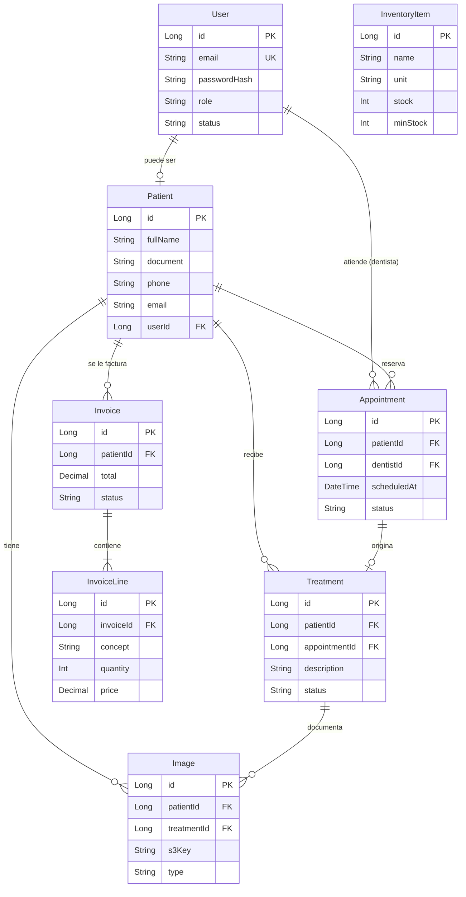

# Modelo de datos (dominio) — OdontoRisas

Base de conocimiento del **dominio de negocio** de la clínica dental. Documento **vivo**: crece y se detalla a medida que cada capacidad se especifica y construye.

- Complementa `docs/architecture.md` (capas), `docs/backend-standards.md` (JPA/persistencia) y `docs/roadmap.md` (capacidades).
- Aquí va el **modelo conceptual** (entidades, relaciones, reglas de negocio de alto nivel). El **esquema físico** lo define Flyway (`backend/.../db/migration`), no este documento.

---

## Fuente de verdad (local-first)

| Tipo de información | Vive en |
|---|---|
| Modelo de dominio (este doc) | `docs/data-model.md` (local) |
| Comportamiento / casos de uso | `openspec/specs/<cap>/spec.md` (Scenarios) |
| Framing de user story ("como X quiero Y") | `proposal.md` del change |
| Backlog / tickets | *(opcional)* — hoy: local. Futuro híbrido: Jira |

> **Nota para el futuro híbrido (Jira).** Si más adelante se adopta Jira: sigue siendo **la capa de backlog**, nunca la fuente de verdad del dominio ni de lo construido. Regla: una sola fuente por tipo de info; el change referencia `JIRA-<id>` de forma cruzada. El dominio y las specs permanecen locales.

---

## Convenciones

- **Nivel de detalle**: aquí se listan entidades y campos **conceptuales** clave. Los tipos exactos, longitudes y validaciones finas se fijan en el `spec.md`/`design.md` de cada capacidad y en la migración Flyway correspondiente.
- Toda entidad tiene `id` (PK) y campos de auditoría (`createdAt`, `updatedAt`) salvo que se indique.
- Identificadores en inglés (convención de código); ver `docs/backend-standards.md`.

---

## Entidades por capacidad

> Estado: **conceptual / por detallar**. Cada capacidad refina su parte al construirse.

### `authentication` / `users` → **User**
Cuenta de acceso al sistema. Un `User` puede o no estar vinculado a un `Patient`.
- `email` (único), `passwordHash`, `role` (`ADMIN` | `USER`), `status` (activo/deshabilitado)
- Refresh/JWT: el token no se modela como entidad salvo que se decida persistir refresh tokens (a definir en `authentication`).

### `patients` → **Patient**
Ficha clínica-administrativa del paciente.
- Datos personales (nombre, documento), contacto (teléfono, email, dirección)
- Vínculo opcional a `User` (si el paciente tiene acceso)

### `appointments` → **Appointment**
Cita agendada.
- `patient` (FK), `dentist` (FK → User con rol clínico), `scheduledAt`, `status` (agendada/atendida/cancelada), `notes`

### `treatments` → **Treatment** (+ historia clínica / odontograma)
Tratamiento realizado o planificado.
- `patient` (FK), `appointment` (FK, opcional), descripción, estado, datos de odontograma/historia (estructura a definir en la capacidad)

### `images` → **Image**
Imagen clínica (radiografía/foto) almacenada en S3.
- `patient` (FK), `treatment` (FK, opcional), `s3Key`, `type` (xray/foto), `uploadedAt`

### `billing` → **Invoice** (+ líneas)
Cobro/factura asociada a tratamientos/citas.
- `patient` (FK), líneas (concepto, cantidad, precio), `total`, `status` (pendiente/pagada)

### `inventory` → **InventoryItem**
Insumo/stock de la clínica.
- `name`, `unit`, `stock`, `minStock` (alerta)

### `dashboard`
No introduce entidades propias: **agrega/consulta** las anteriores (citas, ingresos, ocupación).

---

## Diagrama ER (conceptual)

> Preliminar y de alto nivel; se refina por capacidad.

---

## Cómo se actualiza este documento

1. Al proponer una capacidad (`/opsx:propose`), su `design.md` detalla las entidades/campos nuevos.
2. Al implementarla, la migración Flyway crea el esquema real.
3. Al archivar el change, se **consolida** aquí la parte del dominio afectada (entidades, campos, relaciones y reglas ya construidas), manteniendo el ER al día.
