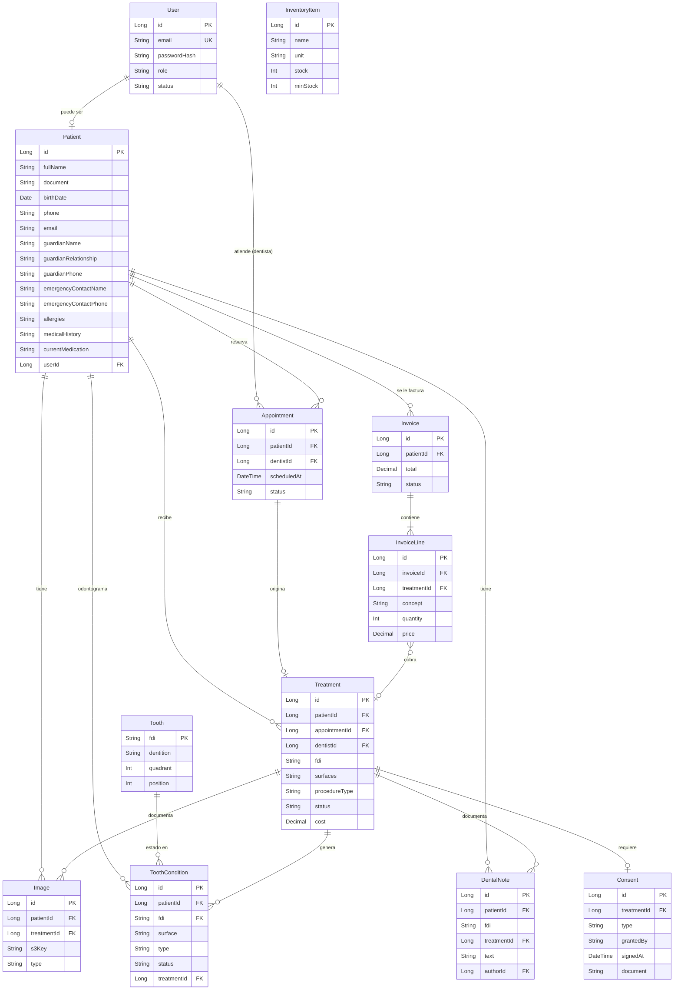

# Modelo de datos (dominio) — OdontoRisas

Base de conocimiento del **dominio de negocio** de la clínica dental. Documento **vivo**: crece y se detalla a medida que cada capacidad se especifica y construye.

- Complementa `docs/architecture.md` (capas), `docs/backend-standards.md` (JPA/persistencia) y `docs/roadmap.md` (capacidades).
- Aquí va el **modelo conceptual** (entidades, relaciones, reglas de negocio de alto nivel). El **esquema físico** lo define Flyway (`backend/.../db/migration`), no este documento.

---

## Fuente de verdad (local-first)

| Tipo de información | Vive en |
|---|---|
| Modelo de dominio (este doc) | `docs/data-model.md` (local) |
| Comportamiento / casos de uso | `openspec/specs/<cap>/spec.md` (Scenarios) |
| Framing de user story ("como X quiero Y") | `proposal.md` del change |
| Backlog / tickets | *(opcional)* — hoy: local. Futuro híbrido: Jira |

> **Nota para el futuro híbrido (Jira).** Si más adelante se adopta Jira: sigue siendo **la capa de backlog**, nunca la fuente de verdad del dominio ni de lo construido. Regla: una sola fuente por tipo de info; el change referencia `JIRA-<id>` de forma cruzada. El dominio y las specs permanecen locales.

---

## Convenciones

- **Nivel de detalle**: aquí se listan entidades y campos **conceptuales** clave. Los tipos exactos, longitudes y validaciones finas se fijan en el `spec.md`/`design.md` de cada capacidad y en la migración Flyway correspondiente.
- Toda entidad tiene `id` (PK) y campos de auditoría (`createdAt`, `updatedAt`) salvo que se indique.
- Identificadores en inglés (convención de código); ver `docs/backend-standards.md`.

---

## Entidades por capacidad

> Estado: **conceptual / por detallar**. Cada capacidad refina su parte al construirse.

### `authentication` / `users` → **User**
Cuenta de acceso al sistema. Un `User` puede o no estar vinculado a un `Patient`.
- `email` (único), `passwordHash`, `role` (`ADMIN` | `USER`), `status` (activo/deshabilitado)
- Refresh/JWT: el token no se modela como entidad salvo que se decida persistir refresh tokens (a definir en `authentication`).

### `patients` → **Patient**
Ficha clínica-administrativa. Se atienden **menores y adultos**.
- Datos personales: `fullName`, `document`, `birthDate` (permite derivar edad e `isMinor`), `sex` (opcional)
- Contacto: `phone`, `email`, `address`
- **Responsable (para menores)** — campos en el propio Patient: `guardianName`, `guardianRelationship` (madre/padre/tutor), `guardianDocument`, `guardianPhone`. Requeridos cuando el paciente es menor de edad.
- **Contacto de emergencia**: `emergencyContactName`, `emergencyContactPhone`, `emergencyContactRelationship`
- **Datos clínicos (anamnesis)** — condicionan el tratamiento: `allergies` (lista; anestesia, penicilina, látex…), `medicalHistory`/`conditions` (diabetes, hipertensión, embarazo, anticoagulantes, cardiopatías…), `currentMedication` (lista)
- Vínculo opcional a `User` (si el paciente tiene acceso al sistema)

**Reglas de negocio que impactan el tratamiento** (a cubrir en los `#### Scenario:` de `patients`/`treatments`):
- Paciente **menor de edad** ⇒ requiere responsable y **consentimiento del tutor** (ver `Consent`).
- **Alergias / antecedentes / medicación** ⇒ deben alertarse/mostrarse antes de registrar un tratamiento.
- La **dentición** del odontograma depende de la edad (ver `treatments`).

### `appointments` → **Appointment**
Cita agendada.
- `patient` (FK), `dentist` (FK → User con rol clínico), `scheduledAt`, `status` (agendada/atendida/cancelada), `notes`

### `treatments` → **Odontograma + Treatment + DentalNote** (núcleo clínico)

El corazón clínico del producto. Notación **FDI/ISO 3950**, registro **por superficie**, denticiones **permanente y temporal**.

**Tooth** (referencia; catálogo de piezas, no por paciente)
- `fdi` (código FDI: permanente 11–48; temporal 51–85), `dentition` (`PERMANENT` | `TEMPORARY`), `quadrant` (1–8), `position` (1–8), `arch` (superior/inferior)
- Superficies aplicables (según anterior/posterior)

**ToothCondition** (el estado del odontograma, por paciente y superficie)
- `patient` (FK), `fdi` (pieza), `surface` (`M` mesial · `D` distal · `V` vestibular · `P`/`L` palatino/lingual · `O`/`I` oclusal/incisal; **null** = condición de pieza completa, p. ej. ausente/implante)
- `type` (caries, obturación, corona, endodoncia, extracción/ausente, fractura, sellante, implante, …)
- `status` (`EXISTING` hallazgo · `PLANNED` planificado · `DONE` realizado)
- `treatment` (FK opcional → Treatment que lo generó), `notedAt`

**Treatment** (procedimiento realizado o planificado)
- `patient` (FK), `appointment` (FK, opcional), `dentist` (FK → User), `fdi` (opcional: pieza afectada), `surfaces` (superficies afectadas; opcional), `procedureType`, `status` (`PLANNED`/`IN_PROGRESS`/`DONE`), `date`, `cost`
- Al completarse, actualiza las `ToothCondition` correspondientes.

**DentalNote** (notas clínicas)
- `patient` (FK), `tooth`/`fdi` (opcional: nota sobre una pieza), `treatment` (FK opcional), `text`, `author` (FK → User), `createdAt`

**Consent** (consentimiento informado, por tratamiento)
- `treatment` (FK), `type`, `grantedBy` (`PATIENT` | `GUARDIAN`), `signedAt`, `document` (opcional: archivo/referencia firmada)
- En **menores**, `grantedBy = GUARDIAN` (usa los datos de responsable del `Patient`).

> **Dentición por edad.** La dentición visible en el odontograma se deriva de `Patient.birthDate`:
> - Menores: **temporal** (51–85) o **mixta** (temporal + permanente en erupción).
> - Adultos: **permanente** (11–48).
> `ToothCondition` es por `fdi`, así que la dentición mixta se soporta de forma natural. Se puede exponer un `dentitionStage` (`TEMPORARY`/`MIXED`/`PERMANENT`) derivado de la edad y ajustable manualmente.

### `images` → **Image**
Imagen clínica (radiografía/foto) almacenada en S3.
- `patient` (FK), `treatment` (FK, opcional), `s3Key`, `type` (xray/foto), `uploadedAt`

### `billing` → **Invoice** (+ líneas)
Cobro/factura asociada a tratamientos/citas.
- `patient` (FK), líneas (`InvoiceLine`: `concept`, `quantity`, `price`, `treatment` FK **opcional** → Treatment), `total`, `status` (pendiente/pagada)
- El vínculo `InvoiceLine → Treatment` permite mostrar los **pagos por tratamiento** dentro de la ficha dental.

### `inventory` → **InventoryItem**
Insumo/stock de la clínica.
- `name`, `unit`, `stock`, `minStock` (alerta)

### `dashboard`
No introduce entidades propias: **agrega/consulta** las anteriores (citas, ingresos, ocupación).

---

## Vista compuesta: Ficha Dental

La **ficha dental** es una **vista/pantalla** del frontend (no una entidad nueva) que centraliza la atención del paciente. Agrega datos de varias capacidades:

| Bloque de la ficha | Fuente (entidades) | Capacidad |
|---|---|---|
| Cabecera del paciente | `Patient` | `patients` |
| **Odontograma** interactivo (FDI, por superficie, permanente+temporal) | `Tooth` + `ToothCondition` | `treatments` |
| Registro de **tratamientos** (por pieza/superficie) | `Treatment` | `treatments` |
| **Notas dentales** | `DentalNote` | `treatments` |
| **Pagos** del paciente / por tratamiento | `Invoice` + `InvoiceLine → Treatment` | `billing` |
| Imágenes (radiografías/fotos) | `Image` | `images` |
| Historial de citas | `Appointment` | `appointments` |

Implicaciones:
- Es **transversal**: se construye de forma incremental a medida que aterrizan sus capacidades. El odontograma interactivo pertenece a `treatments`; los pagos a `billing`; etc.
- La pantalla vivirá en el frontend (probablemente `frontend/src/screens/patients/` o un módulo `treatments`), orquestando componentes de esos módulos (ver `docs/architecture.md`).
- Al specificar `treatments`, sus `#### Scenario:` deben cubrir el odontograma (marcar hallazgo por superficie, registrar/planificar tratamiento en una pieza, agregar nota) — porque de ahí salen los tests.

---

## Diagrama ER (conceptual)

> Preliminar y de alto nivel; se refina por capacidad.

---

## Cómo se actualiza este documento

1. Al proponer una capacidad (`/opsx:propose`), su `design.md` detalla las entidades/campos nuevos.
2. Al implementarla, la migración Flyway crea el esquema real.
3. Al archivar el change, se **consolida** aquí la parte del dominio afectada (entidades, campos, relaciones y reglas ya construidas), manteniendo el ER al día.
