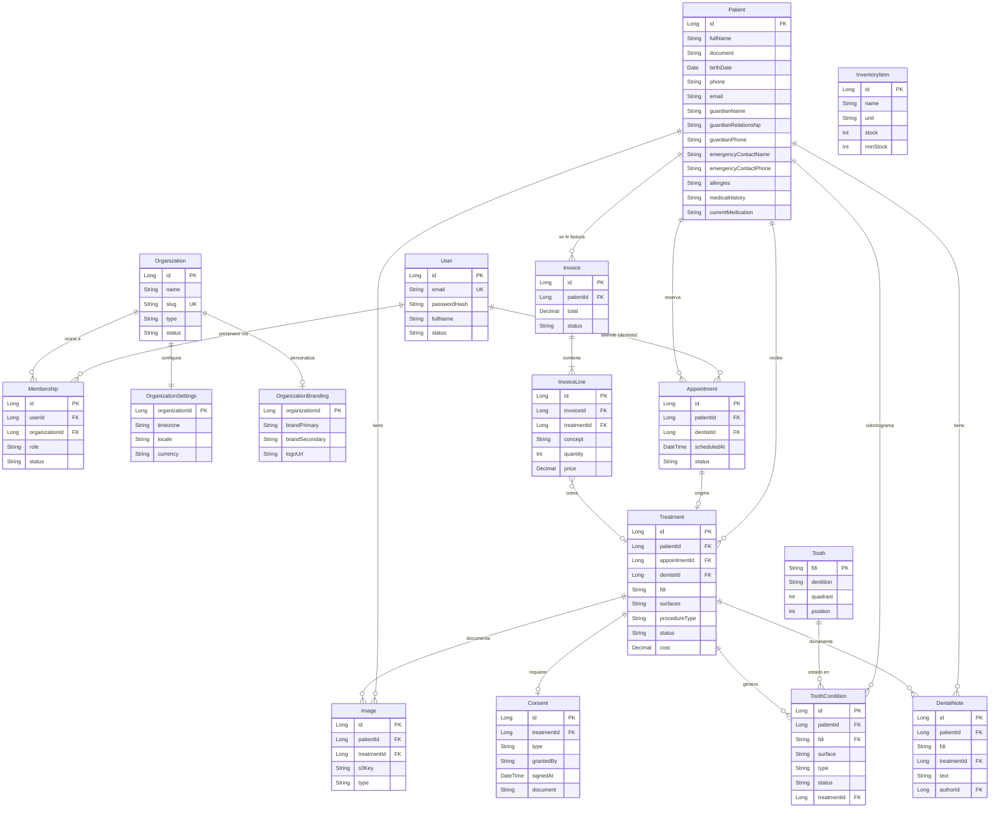

# Dominio de negocio — OdontoRisas

Dimensión de **negocio** (sustituible por proyecto). Base de conocimiento del dominio de la clínica dental: actores, glosario y modelo conceptual. Documento **vivo**: crece y se detalla a medida que cada capacidad se especifica y construye.

- Complementa `docs/vision.md` (objetivos + roadmap), `docs/architecture.md` (capas) y `docs/backend.md` (JPA/persistencia).
- Aquí va el **modelo conceptual** (entidades, relaciones, reglas de negocio de alto nivel). El **esquema físico** lo define Flyway (`modules/backend/.../db/migration`), no este documento.

---

## Actores del negocio

| Actor | Descripción | Rol de sistema (aprox.) |
|---|---|---|
| **Administrador** | Gestiona la clínica: usuarios/staff, facturación, inventario y métricas del panel. | `ADMIN` |
| **Dentista / Odontólogo** | Personal clínico: atiende citas, registra tratamientos y odontograma, notas e imágenes. | `USER` (rol clínico) |
| **Paciente** | Persona atendida (menor o adulto). Es un **cliente de la clínica**: un registro clínico-administrativo, **no una identidad del sistema**. No tiene cuenta ni inicia sesión; lo da de alta el staff. | — (sin cuenta) |
| **Tutor / Responsable** | Adulto responsable de un paciente **menor**. No es necesariamente usuario del sistema; sus datos viven en el `Patient`. Otorga el consentimiento en menores. | — |

> Los roles de sistema (`ADMIN`/`USER`) los define `authentication`; el mapeo fino de permisos clínicos se detalla al construir `users`/`patients`/`treatments`.

## Glosario de términos clave

| Término | Significado |
|---|---|
| **Organización (tenant)** | Cliente del SaaS que se aísla del resto. En este producto, una **clínica** es una organización. |
| **Identidad** | La persona (`User`), única en toda la plataforma (correo único global). No tiene rol ni organización propios. |
| **Membresía** | Pertenencia de una identidad a una organización, con su **rol** en ella. Un usuario puede tener varias. |
| **Aislamiento (multi-tenant)** | Garantía de que una organización no ve ni escribe datos de otra. Dos capas: filtrado de aplicación (`@TenantId`) + Row-Level Security en PostgreSQL. |
| **Ficha dental** | Vista compuesta (pantalla) que centraliza la atención de un paciente: datos, odontograma, tratamientos, notas, pagos, imágenes e historial de citas. No es una entidad. |
| **Odontograma** | Representación del estado dental del paciente pieza por pieza y por superficie. |
| **Notación FDI (ISO 3950)** | Código de dos dígitos por pieza (permanentes 11–48; temporales 51–85). |
| **Dentición** | Conjunto de piezas: **temporal** (de leche), **permanente** (adulta) o **mixta** (transición en menores). Se deriva de la edad. |
| **Superficie dental** | Cara de una pieza: `M` mesial · `D` distal · `V` vestibular · `P`/`L` palatino/lingual · `O`/`I` oclusal/incisal. |
| **Cuadrante** | Cada una de las divisiones de la boca; primer dígito del código FDI. |
| **Anamnesis** | Antecedentes clínicos del paciente (alergias, condiciones, medicación) que condicionan el tratamiento. |
| **Consentimiento informado** | Autorización del tratamiento; en menores lo otorga el tutor/responsable. |

---

## Fuente de verdad (local-first)

| Tipo de información | Vive en |
|---|---|
| Modelo de dominio (este doc) | `docs/domain.md` (local) |
| Comportamiento / casos de uso | `openspec/specs/<cap>/spec.md` (Scenarios) |
| Framing de user story ("como X quiero Y") | `proposal.md` del change |
| Backlog / tickets | *(opcional)* — hoy: local. Futuro híbrido: Jira |

> **Nota para el futuro híbrido (Jira).** Si más adelante se adopta Jira: sigue siendo **la capa de backlog**, nunca la fuente de verdad del dominio ni de lo construido. Regla: una sola fuente por tipo de info; el change referencia `JIRA-<id>` de forma cruzada. El dominio y las specs permanecen locales.

---

## Convenciones

- **Nivel de detalle**: aquí se listan entidades y campos **conceptuales** clave. Los tipos exactos, longitudes y validaciones finas se fijan en el `spec.md`/`design.md` de cada capacidad y en la migración Flyway correspondiente.
- Toda entidad tiene `id` (PK) y campos de auditoría (`createdAt`, `updatedAt`) salvo que se indique.
- Identificadores en inglés (convención de código); ver `docs/backend.md`.

---

## Entidades por capacidad

> Estado: **conceptual / por detallar**. Cada capacidad refina su parte al construirse.

### `authentication` / `users` → **User** *(identidad global; construida)*
**Identidad** de una persona en la plataforma: existe **una sola vez** (correo único global) y **no tiene rol ni organización propios** (el rol vive en `Membership`). Los `User` son el **staff de la clínica** (administrador, recepción, odontólogos): son quienes inician sesión. Los **pacientes NO son usuarios** (ver `Patient`).
- **Construido**: `email` (único global), `passwordHash` (BCrypt), `fullName`, `status` (`ACTIVE` | `LOCKED` | `DISABLED`), `createdAt`/`updatedAt`.
- **Movido a `Membership`** (en `multi-tenancy`): `role`. **Diferido a la capacidad `users`**: `username` (único), `phone`, `country`.

### `multi-tenancy` → **Organization** *(el tenant; construida)*
La organización cliente del SaaS (una **clínica** es una organización). Es el sujeto del aislamiento de datos de negocio.
- `name`, `slug` (único, **inmutable**), `type` (`OrganizationType`, hoy `CLINIC`), `status` (`ACTIVE` | `SUSPENDED`), `createdAt`/`updatedAt`.

### `multi-tenancy` → **OrganizationSettings** *(construida)*
Configuración 1:1 de la organización (punto de extensión).
- `organizationId` (PK/FK, comparte clave con `Organization`), `timezone`, `locale`, `currency`.

### `multi-tenancy` → **Membership** *(puente identidad↔organización; construida)*
Define a qué organización pertenece un usuario y **con qué rol**. Es el corazón del modelo multi-tenant. Un usuario puede tener varias membresías (multi-organización); en el MVP el registro crea una (rol `ADMIN`) y el selector se difiere a `users`.
- `user` (FK), `organization` (FK), `role` (`ADMIN` | `USER`), `status` (`ACTIVE` | `INACTIVE` | `SUSPENDED`), único `(user, organization)`, timestamps.
- Aislada por **identidad** (Row-Level Security sobre `user_id`).

### `authentication` → **RefreshToken** *(construida)*
Token de refresco persistido para rotación y revocación real (logout). Se guarda el **hash** del token, nunca el valor en claro.
- `user` (FK), `tokenHash` (único), `expiresAt`, `revoked`, `createdAt`. El access token es JWT stateless (no se persiste); lleva la organización activa en el claim `oid`.

### `organization-branding` → **OrganizationBranding** *(1:1 con Organization; construida)*
Personalización visual de una organización aplicada al app shell. Fila **opcional**: si no existe, la organización usa la marca por defecto del producto; si todos los campos quedan vacíos, la fila se elimina.
- `organizationId` (PK/FK, comparte clave con `Organization` vía `@MapsId`), `brandPrimary` (hex `#RRGGBB`, nullable), `brandSecondary` (hex, nullable), `logoUrl` (URL `https`, nullable).
- **Sin RLS**: es estética pública dentro de la sesión y se lee por el contexto de organización; no contiene datos de negocio sensibles (ver `docs/backend.md §8.1`). El tema se **deriva** en el frontend (contraste WCAG AA, respeta modo claro/oscuro); los colores semánticos no cambian con la marca.

> **Regla de aislamiento (multi-tenancy).** Toda entidad de **negocio** (`Patient`, `Appointment`, `Treatment`, `Invoice`…) pertenece a una organización: lleva `organizationId` + Row-Level Security por organización. `users`/`refresh_tokens` son dominio de auth (sin RLS por organización); `memberships` se aísla por identidad. Ver `docs/backend.md §8.1` y `openspec/specs/multi-tenancy/`.

### `patients` → **Patient**
Ficha clínica-administrativa. Se atienden **menores y adultos**.
- Datos personales: `fullName`, `document`, `birthDate` (permite derivar edad e `isMinor`), `sex` (opcional)
- Contacto: `phone`, `email`, `address`
- **Responsable (para menores)** — campos en el propio Patient: `guardianName`, `guardianRelationship` (madre/padre/tutor), `guardianDocument`, `guardianPhone`. Requeridos cuando el paciente es menor de edad.
- **Contacto de emergencia**: `emergencyContactName`, `emergencyContactPhone`, `emergencyContactRelationship`
- **Datos clínicos (anamnesis)** — condicionan el tratamiento: `allergies` (lista; anestesia, penicilina, látex…), `medicalHistory`/`conditions` (diabetes, hipertensión, embarazo, anticoagulantes, cardiopatías…), `currentMedication` (lista)
- **NO es un usuario del sistema.** El paciente es un **cliente de la clínica**: solo un registro. No tiene cuenta, no inicia sesión y no se vincula a ningún `User`. Lo dan de alta el administrador o la recepcionista (que sí son `User`). *Un eventual portal del paciente sería una capacidad futura y añadiría el vínculo en ese momento; hoy queda fuera de alcance.*

**Reglas de negocio que impactan el tratamiento** (a cubrir en los `#### Scenario:` de `patients`/`treatments`):
- Paciente **menor de edad** ⇒ requiere responsable y **consentimiento del tutor** (ver `Consent`).
- **Alergias / antecedentes / medicación** ⇒ deben alertarse/mostrarse antes de registrar un tratamiento.
- La **dentición** del odontograma depende de la edad (ver `treatments`).

### `appointments` → **Appointment**
Cita agendada.
- `patient` (FK), `dentist` (FK → User con rol clínico), `scheduledAt`, `status` (agendada/atendida/cancelada), `notes`

> **Dos capacidades, no una** (`docs/vision.md §2`). El núcleo clínico se parte por **sustantivo**:
> **`dental-chart`** es el **estado** de la boca (el odontograma) y **`treatments`** son las **acciones** que lo cambian. Juntas necesitaban una "y" y cargaban con cinco entidades: mala granularidad.
> `treatments` **depende de** `dental-chart` (al completarse un tratamiento, actualiza el estado).

### `dental-chart` → **Tooth + ToothCondition** (el odontograma: el ESTADO)

El estado dental pieza a pieza y **por superficie**. Notación **FDI/ISO 3950**, denticiones **permanente y temporal**.

**Tooth** (referencia; catálogo de piezas, no por paciente)
- `fdi` (código FDI: permanente 11–48; temporal 51–85), `dentition` (`PERMANENT` | `TEMPORARY`), `quadrant` (1–8), `position` (1–8), `arch` (superior/inferior)
- Superficies aplicables (según anterior/posterior)

**ToothCondition** (el estado del odontograma, por paciente y superficie)
- `patient` (FK), `fdi` (pieza), `surface` (`M` mesial · `D` distal · `V` vestibular · `P`/`L` palatino/lingual · `O`/`I` oclusal/incisal; **null** = condición de pieza completa, p. ej. ausente/implante)
- `type` (caries, obturación, corona, endodoncia, extracción/ausente, fractura, sellante, implante, …)
- `status` (`EXISTING` hallazgo · `PLANNED` planificado · `DONE` realizado)
- `treatment` (FK opcional → Treatment que lo generó), `notedAt`

### `treatments` → **Treatment + DentalNote + Consent** (las ACCIONES)

Lo que el odontólogo *hace*, con su coste y su consentimiento. Al completarse, **actualiza el estado** que gestiona `dental-chart`.

**Treatment** (procedimiento realizado o planificado)
- `patient` (FK), `appointment` (FK, opcional), `dentist` (FK → User), `fdi` (opcional: pieza afectada), `surfaces` (superficies afectadas; opcional), `procedureType`, `status` (`PLANNED`/`IN_PROGRESS`/`DONE`), `date`, `cost`
- Al completarse, actualiza las `ToothCondition` correspondientes.

**DentalNote** (notas clínicas)
- `patient` (FK), `tooth`/`fdi` (opcional: nota sobre una pieza), `treatment` (FK opcional), `text`, `author` (FK → User), `createdAt`

**Consent** (consentimiento informado, por tratamiento)
- `treatment` (FK), `type`, `grantedBy` (`PATIENT` | `GUARDIAN`), `signedAt`, `document` (opcional: archivo/referencia firmada)
- En **menores**, `grantedBy = GUARDIAN` (usa los datos de responsable del `Patient`).

> **Dentición por edad.** La dentición visible en el odontograma se deriva de `Patient.birthDate`:
> - Menores: **temporal** (51–85) o **mixta** (temporal + permanente en erupción).
> - Adultos: **permanente** (11–48).
> `ToothCondition` es por `fdi`, así que la dentición mixta se soporta de forma natural. Se puede exponer un `dentitionStage` (`TEMPORARY`/`MIXED`/`PERMANENT`) derivado de la edad y ajustable manualmente.

### `images` → **Image**
Imagen clínica (radiografía/foto) almacenada en S3.
- `patient` (FK), `treatment` (FK, opcional), `s3Key`, `type` (xray/foto), `uploadedAt`

### `billing` → **Invoice** (+ líneas)
Cobro/factura asociada a tratamientos/citas.
- `patient` (FK), líneas (`InvoiceLine`: `concept`, `quantity`, `price`, `treatment` FK **opcional** → Treatment), `total`, `status` (pendiente/pagada)
- El vínculo `InvoiceLine → Treatment` permite mostrar los **pagos por tratamiento** dentro de la ficha dental.

### `inventory` → **InventoryItem**
Insumo/stock de la clínica.
- `name`, `unit`, `stock`, `minStock` (alerta)

### `dashboard`
No introduce entidades propias: **agrega/consulta** las anteriores (citas, ingresos, ocupación).

---

## Vista compuesta: Ficha Dental

La **ficha dental** es una **vista/pantalla** del frontend (no una entidad nueva) que centraliza la atención del paciente. Agrega datos de varias capacidades:

| Bloque de la ficha | Fuente (entidades) | Capacidad |
|---|---|---|
| Cabecera del paciente | `Patient` | `patients` |
| **Odontograma** interactivo (FDI, por superficie, permanente+temporal) | `Tooth` + `ToothCondition` | **`dental-chart`** |
| Registro de **tratamientos** (por pieza/superficie) | `Treatment` | `treatments` |
| **Notas dentales** | `DentalNote` | `treatments` |
| **Pagos** del paciente / por tratamiento | `Invoice` + `InvoiceLine → Treatment` | `billing` |
| Imágenes (radiografías/fotos) | `Image` | `images` |
| Historial de citas | `Appointment` | `appointments` |

Implicaciones:
- Es **transversal**: se construye de forma incremental a medida que aterrizan sus capacidades. El odontograma interactivo pertenece a `treatments`; los pagos a `billing`; etc.
- La pantalla vivirá en el frontend (probablemente `modules/frontend/src/screens/patients/` o un módulo `treatments`), orquestando componentes de esos módulos (ver `docs/architecture.md`).
- Al specificar `treatments`, sus `#### Scenario:` deben cubrir el odontograma (marcar hallazgo por superficie, registrar/planificar tratamiento en una pieza, agregar nota) — porque de ahí salen los tests.

---

## Diagrama ER (conceptual)

> Preliminar y de alto nivel; se refina por capacidad.

---

## Cómo se actualiza este documento

1. Al proponer una capacidad (`/opsx:propose`), su `design.md` detalla las entidades/campos nuevos.
2. Al implementarla, la migración Flyway crea el esquema real.
3. Al archivar el change, se **consolida** aquí la parte del dominio afectada (entidades, campos, relaciones y reglas ya construidas), manteniendo el ER al día.
