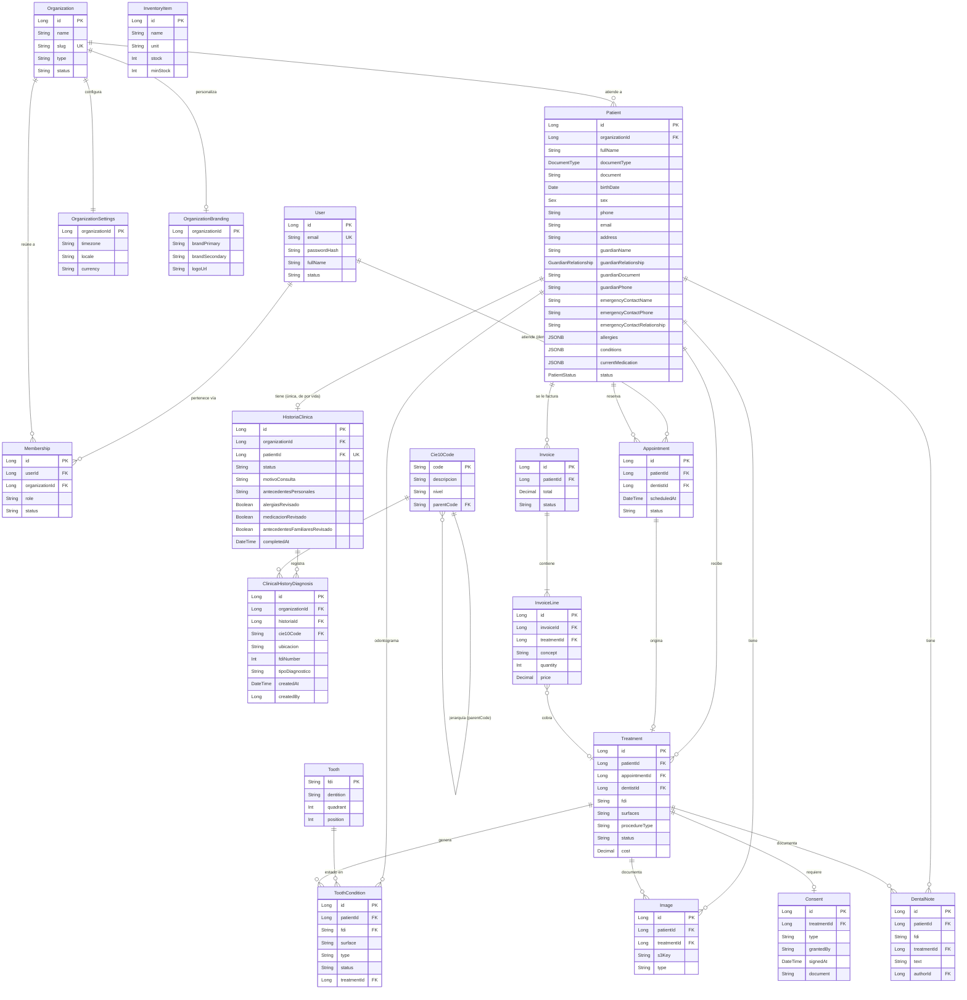

# Dominio de negocio — OdontoRisas

Dimensión de **negocio** (sustituible por proyecto). Base de conocimiento del dominio de la clínica dental: actores, glosario y modelo conceptual. Documento **vivo**: crece y se detalla a medida que cada capacidad se especifica y construye.

- Complementa `docs/vision.md` (objetivos + roadmap), `docs/architecture.md` (capas) y `docs/backend.md` (JPA/persistencia).
- Aquí va el **modelo conceptual** (entidades, relaciones, reglas de negocio de alto nivel). El **esquema físico** lo define Flyway (`modules/backend/.../db/migration`), no este documento.

---

## Actores del negocio

| Actor | Descripción | Rol |
|---|---|---|
| **Administrador** | El dueño o gerente. Gestiona **el personal**, la facturación, el inventario y las métricas. En la clínica pequeña **suele ser también el odontólogo**, por eso su rol lo abarca todo. | `ADMIN` |
| **Odontólogo / Dentista** | Personal **clínico**. Es el único que realiza el **acto clínico**: odontograma, diagnósticos, tratamientos, notas e imágenes. | `DENTIST` |
| **Recepcionista** | Personal **administrativo**. Agenda y reprograma citas, da de alta pacientes y cobra. **No realiza actos clínicos.** | `RECEPTIONIST` |
| **Paciente** | Persona atendida (menor o adulto). Es un **cliente de la clínica**: un registro clínico-administrativo, **no una identidad del sistema**. No tiene cuenta ni inicia sesión; lo da de alta el staff. | — (sin cuenta) |
| **Tutor / Responsable** | Adulto responsable de un paciente **menor**. No es necesariamente usuario del sistema; sus datos viven en el `Patient`. Otorga el consentimiento en menores. | — |

> **Actor ≠ rol.** El **actor** es *quién eres en la clínica* (existe aunque no haya software); el **rol** es *qué te deja hacer el sistema*. El mapeo **no es 1:1**:
> - Hay **actores sin rol**: el paciente y el tutor no entran al sistema.
> - Un **rol cubre varios actores**: `ADMIN` vale para el dueño y para un gerente.
> - Un **actor puede tener varios roles**, porque **el rol vive en la membresía, no en la persona**: Ana es `ADMIN` en su clínica y `DENTIST` en otra donde colabora los martes. El actor es global (*"soy odontóloga"*); el rol es **por clínica**. El modelo ya lo soporta.

**La frontera que de verdad importa: el acto clínico.**

| | Agenda · Pacientes · Cobros | Odontograma · Diagnóstico · Tratamientos | Personal · Inventario · Ajustes |
|---|:---:|:---:|:---:|
| `ADMIN` | ✅ | ✅ | ✅ |
| `DENTIST` | ✅ | ✅ | ❌ |
| `RECEPTIONIST` | ✅ | ❌ **nunca** | ❌ |

> Que un recepcionista **no pueda tocar el odontograma ni registrar un diagnóstico** no es un capricho de permisos: es un **acto clínico**, con responsabilidad profesional detrás. Es la razón de ser de este desglose.
>
> `ADMIN` puede todo —incluido lo clínico— porque **el dueño de una clínica pequeña normalmente es el odontólogo**. La contrapartida asumida: un gerente **no** clínico con rol `ADMIN` tendría acceso clínico. Si algún día hace falta separarlo (clínica grande con gerente administrativo), la evolución natural es desdoblar en *rol clínico* + *flag de administración*.

> ⚠️ **Estado: decidido, aún no construido.** Hoy el sistema solo tiene **`ADMIN` | `USER`** (`multi-tenancy`, construida): el dentista y la recepcionista compartirían rol, y la recepcionista **podría** tocar el odontograma. Esta tabla describe el modelo **acordado**, que implementará la capacidad **`staff`** (fila 2 del roadmap) — la que asigna los roles, y que **no se puede especificar sin decidir esto primero**.
>
> Como `Membership.role` pertenece a `multi-tenancy`, el change `add-staff` llevará también un **delta sobre esa capacidad** (`docs/vision.md §5` lo contempla: *"si toca varias, crea un `spec.md` delta por cada una"*).

## Glosario de términos clave

| Término | Significado |
|---|---|
| **Organización (tenant)** | Cliente del SaaS que se aísla del resto. En este producto, una **clínica** es una organización. |
| **Identidad** | La persona (`User`), única en toda la plataforma (correo único global). No tiene rol ni organización propios. |
| **Membresía** | Pertenencia de una identidad a una organización, con su **rol** en ella. Un usuario puede tener varias. |
| **Aislamiento (multi-tenant)** | Garantía de que una clínica **no ve ni modifica** los datos de otra, aunque compartan la instalación. Es la promesa central del SaaS. *(Cómo se implementa: `docs/backend.md §8.1`.)* |
| **Ficha dental** | Vista compuesta (pantalla) que centraliza la atención de un paciente: datos, odontograma, tratamientos, notas, pagos, imágenes e historial de citas. No es una entidad. |
| **Odontograma** | Representación del estado dental del paciente pieza por pieza y por superficie. |
| **Notación FDI (ISO 3950)** | Código de dos dígitos por pieza (permanentes 11–48; temporales 51–85). |
| **Dentición** | Conjunto de piezas: **temporal** (de leche), **permanente** (adulta) o **mixta** (transición en menores). Se deriva de la edad. |
| **Superficie dental** | Cara de una pieza: `M` mesial · `D` distal · `V` vestibular · `P`/`L` palatino/lingual · `O`/`I` oclusal/incisal. |
| **Cuadrante** | Cada una de las divisiones de la boca; primer dígito del código FDI. |
| **Anamnesis** | Antecedentes clínicos del paciente (alergias, condiciones, medicación) que condicionan el tratamiento. |
| **Consentimiento informado** | Autorización del tratamiento; en menores lo otorga el tutor/responsable. |

---

## Fuente de verdad (local-first)

| Tipo de información | Vive en |
|---|---|
| Modelo de dominio (este doc) | `docs/domain.md` (local) |
| Comportamiento / casos de uso | `openspec/specs/<cap>/spec.md` (Scenarios) |
| Framing de user story ("como X quiero Y") | `proposal.md` del change |
| Backlog / tickets | *(opcional)* — hoy: local. Futuro híbrido: Jira |

> **Nota para el futuro híbrido (Jira).** Si más adelante se adopta Jira: sigue siendo **la capa de backlog**, nunca la fuente de verdad del dominio ni de lo construido. Regla: una sola fuente por tipo de info; el change referencia `JIRA-<id>` de forma cruzada. El dominio y las specs permanecen locales.

---

## Convenciones

### 🧪 El criterio: ¿lo reconocería un odontólogo?

Este documento describe **el negocio**, no cómo se implementa. Ante la duda sobre si algo pertenece aquí, pregúntate si **una persona de la clínica lo entendería sin saber programar**:

| ✅ Sí es dominio | ❌ No es dominio (va a `docs/backend.md` / `architecture.md`) |
|---|---|
| Paciente · Odontograma · Tratamiento · Consentimiento | Flyway · Hibernate · `@MapsId` · BCrypt |
| **Clínica** (la organización) · **quién trabaja aquí y con qué rol** | **Cómo** se aísla una clínica de otra (RLS, `@TenantId`) |
| Que el usuario **inicia sesión** | JWT, claims, `tokenHash`, rotación del refresh |

> Ojo con el error inverso: **`Organization` y `Membership` SÍ son dominio.** Que *"la clínica es el cliente del SaaS"* y que *"esta persona trabaja aquí como administradora"* son hechos del negocio, no detalles técnicos. Lo técnico es **cómo** se garantizan.

- **Nivel de detalle**: aquí se listan entidades y campos **conceptuales** clave. Los tipos exactos, longitudes y validaciones finas se fijan en el `spec.md`/`design.md` de cada capacidad y en la migración Flyway correspondiente.
- Toda entidad tiene `id` (PK) y campos de auditoría (`createdAt`, `updatedAt`) salvo que se indique.
- Identificadores en inglés (convención de código); ver `docs/backend.md`.

---

## Entidades

> Estado: **conceptual / por detallar**. Cada capacidad refina su parte al construirse.
> Se agrupan en dos planos, porque responden a preguntas distintas.

---

# 🏢 Dominio de plataforma — *el SaaS*

*Quién entra al sistema, a qué clínica pertenece y con qué rol.* Es genérico y **reutilizable en cualquier SaaS multi-tenant**, no tiene nada de dental.

### `authentication` → **User** *(identidad global; construida)*
**Identidad** de una persona en la plataforma: existe **una sola vez** (correo único global) y **no tiene rol ni organización propios** (el rol vive en `Membership`). Los `User` son el **staff de la clínica** (administrador, recepción, odontólogos): son quienes inician sesión. Los **pacientes NO son usuarios** (ver `Patient`).
- **Construido**: `email` (único global), la contraseña (**se guarda cifrada, nunca en claro**), `fullName`, `status` (`ACTIVE` | `LOCKED` | `DISABLED`), `createdAt`/`updatedAt`.
- **Construido** (change `update-authentication`, bloqueo por intentos fallidos): `failedLoginAttempts` (contador) + `lockedUntil` (ventana de bloqueo temporal). **Independiente** de `status` — `LOCKED`/`DISABLED` es un bloqueo **administrativo y permanente** (lo levanta una persona); `lockedUntil` es **automático y temporal** (se expira solo). Reutilizar `status` para esto habría obligado a devolverlo a `ACTIVE` al expirar la ventana, resucitando una cuenta que un admin bloqueó a mano.
- **Movido a `Membership`** (en `multi-tenancy`): `role`. **Diferido al change `update-authentication`** (el *perfil*, no el alta): `username` (único), `phone`, `country`.

### `multi-tenancy` → **Organization** *(el tenant; construida)*
La organización cliente del SaaS (una **clínica** es una organización). Es el sujeto del aislamiento de datos de negocio.
- `name`, `slug` (único, **inmutable**), `type` (`OrganizationType`, hoy `CLINIC`), `status` (`ACTIVE` | `SUSPENDED`), `createdAt`/`updatedAt`.

### `multi-tenancy` → **OrganizationSettings** *(construida)*
Configuración 1:1 de la organización (punto de extensión).
- `organizationId` (PK/FK, comparte clave con `Organization`), `timezone`, `locale`, `currency`.

### `multi-tenancy` → **Membership** *(puente identidad↔organización; construida)*
Define a qué organización pertenece un usuario y **con qué rol**. Es el corazón del modelo multi-tenant. Un usuario puede tener varias membresías (multi-organización); en el MVP el registro crea una (rol `ADMIN`); **quién más pertenece a la organización lo gestiona `staff`**, y el **selector de organización activa** se difiere al change `update-multi-tenancy` (es re-emitir el token con otro `oid`: una operación de sesión).
- `user` (FK), `organization` (FK), **`role`**, `status` (`ACTIVE` | `INACTIVE` | `SUSPENDED`), único `(user, organization)`, timestamps.
- **El rol vive aquí, no en el `User`** — por eso una misma persona puede ser `ADMIN` en su clínica y `DENTIST` en otra. Hoy construido: `ADMIN` | `USER`. **Decidido y pendiente**: `ADMIN` | `DENTIST` | `RECEPTIONIST` (lo implementa `add-staff`; ver la tabla de actores).
- **Regla:** un usuario solo ve sus propias membresías (nunca las de otro). *Cómo* se garantiza, en `docs/backend.md §8.1`.

> **La sesión no se modela aquí.** Que el usuario *inicia sesión*, que la sesión *sabe en qué clínica está* y que *se puede cerrar de verdad* son hechos del negocio; el **cómo** (tokens, rotación, revocación, claims) es implementación de `authentication` — vive en `docs/backend.md §11` y en `openspec/specs/authentication/`.

### `organization-branding` → **OrganizationBranding** *(1:1 con Organization; construida)*
Personalización visual de una organización aplicada al app shell. Fila **opcional**: si no existe, la organización usa la marca por defecto del producto; si todos los campos quedan vacíos, la fila se elimina.
- `organizationId` (comparte clave con `Organization`), `brandPrimary` (hex `#RRGGBB`), `brandSecondary`, `logoUrl` (URL `https`). Todos opcionales.
- El tema se **deriva** del color de marca garantizando contraste legible, y respeta el modo claro/oscuro; los colores semánticos (éxito, aviso, error) **no** cambian con la marca. *(Es estética, no dato sensible: ver `ADR-0003` para por qué no lleva aislamiento a nivel de motor.)*

---

# 🦷 Dominio del negocio — *la clínica dental*

*A quién se atiende y qué se le hace.* Aquí vive el conocimiento dental del producto.

> 🔒 **Toda entidad de este bloque pertenece a una clínica**: una clínica **nunca** ve ni modifica los datos de otra. Es la garantía central del SaaS.
>
> **Cómo se implementa esa garantía NO se documenta aquí** (sería duplicarlo, y dos fuentes acaban divergiendo). Vive en un único sitio: **`docs/backend.md §8.1`**.

### `patients` → **Patient**
Ficha clínica-administrativa. Se atienden **menores y adultos**.
- Datos personales: `fullName`, `birthDate` (permite derivar edad e `isMinor`), `sex` (opcional, **enum** `MALE|FEMALE|OTHER`), y el **documento**: `documentType` (**enum** `DNI|CE|PASSPORT`) + `document` (**string**, nunca numérico — ceros a la izquierda, pasaporte alfanumérico). Van **emparejados** (o ambos o ninguno) y el **formato depende del tipo** (DNI=8 díg, CE=9–12, pasaporte=alfanum). Único por clínica (`ADR-0004`, `add-patients` design.md D8).
- Contacto: `phone`, `email`, `address` (los teléfonos son **string con formato**, no numéricos). **El teléfono se puede compartir** entre pacientes de la misma clínica (familias) — no es un error de validación: al chocar, el sistema **avisa** (no bloquea), calculado sobre la clínica activa (`update-patients`, `ADR-0010`).
- **Responsable (para menores)** — campos en el propio Patient: `guardianName`, `guardianRelationship` (**enum** `MOTHER|FATHER|GUARDIAN|OTHER`) y `guardianPhone`, **requeridos** cuando el paciente es menor de edad; `guardianDocument` **opcional** (no siempre está a mano y no debe bloquear la atención).
- **Contacto de emergencia**: `emergencyContactName`, `emergencyContactPhone`, `emergencyContactRelationship` — **obligatorio solo cuando el paciente no tiene teléfono propio** (regla condicional, mismo mecanismo que el responsable de menores); si hay teléfono propio, sigue siendo opcional (`update-patients`, `ADR-0010`).
- **Datos clínicos (anamnesis)** — condicionan el tratamiento: `allergies` (lista; anestesia, penicilina, látex…), `medicalHistory`/`conditions` (diabetes, hipertensión, embarazo, anticoagulantes, cardiopatías…), `currentMedication` (lista)
- **NO es un usuario del sistema.** El paciente es un **cliente de la clínica**: solo un registro. No tiene cuenta, no inicia sesión y no se vincula a ningún `User`. Lo dan de alta el administrador o la recepcionista (que sí son `User`). *Un eventual portal del paciente sería una capacidad futura y añadiría el vínculo en ese momento; hoy queda fuera de alcance.*
- **El paciente pertenece a UNA clínica**, no a la plataforma. La misma persona atendida en dos clínicas son **dos `Patient` distintos**, sin relación entre sí: **ninguna clínica sabe que la otra la atiende**. Los datos demográficos se **duplican** (es el precio de la privacidad) y la información clínica **nunca se comparte**.
  > ⚠️ **El documento (DNI) es único POR CLÍNICA**: la restricción va sobre `(organizationId, document)`, **nunca** sobre `document` a secas — eso impediría que dos clínicas atendieran al mismo paciente.
  >
  > El *porqué*, las alternativas descartadas y el resto de consecuencias: **`ADR-0004`**.
  >
  > Ante un documento duplicado, la respuesta **identifica la ficha existente** (su `id`) para que el cliente pueda ofrecer abrirla directamente, en vez de solo rechazar (`update-patients`, `ADR-0009`).

**Reglas de negocio que impactan el tratamiento** (a cubrir en los `#### Scenario:` de `patients`/`treatments`):
- Paciente **menor de edad** ⇒ requiere responsable y **consentimiento del tutor** (ver `Consent`).
- **Alergias / antecedentes / medicación** ⇒ deben alertarse/mostrarse antes de registrar un tratamiento.
- La **dentición** del odontograma depende de la edad (ver `treatments`).

### `clinical-history` → **HistoriaClinica + ClinicalHistoryDiagnosis** *(documento inicial; construida)*

El documento médico-legal inicial de la atención: **una por paciente, de por vida, por clínica** (misma cardinalidad que `Patient`, `ADR-0004`), con ciclo `DRAFT→COMPLETED`. Prerrequisito de cualquier tratamiento (`ADR-0011`). **No** guarda columnas de filiación — la lee de `Patient` en el mapper, así refleja siempre el dato vigente aun sellada.

**HistoriaClinica**
- `patient` (FK, **único**: una por paciente/clínica), `status` (`DRAFT` | `COMPLETED`), `motivoConsulta`, `enfermedadActual`, `antecedentesPersonales`, `examenClinico`, `pronostico`, `signosVitales` (JSONB), `completedAt`.
- **Patrón revisado/detalle** en alergias, medicación y antecedentes familiares: cada uno lleva un flag `*Revisado` (booleano, afirmativo) + `*Detalle` (texto libre, opcional). Un campo vacío **no** cuenta como revisado — la ausencia se registra afirmando "sin hallazgos", no dejando el campo en blanco. Es dato clínico distinto de `Patient.allergies`/`conditions`/`currentMedication` (esta capacidad **no** los lee, copia ni modifica; retirarlos de `Patient` es un `update-patients` futuro, ver `docs/vision.md §3`).
- El sellado (`DRAFT→COMPLETED`) es **manual, unidireccional y validado en el servidor** (checklist mínimo: motivo, antecedentes personales, examen clínico, pronóstico, los tres flags de revisión, y ≥1 diagnóstico). Una vez `COMPLETED`, la información inicial queda fija — rechazado en el servidor aunque la petición llegue directa a la API, no solo por bloqueo visual.

**ClinicalHistoryDiagnosis**
- `historia` (FK), `cie10Code` (FK lógica al catálogo CIE10), `ubicacion` (`GENERAL` | `PIEZA`), `fdiNumber` (obligatorio solo si `PIEZA`, del conjunto FDI real), `tipoDiagnostico` (`PRESUNTIVO` | `DEFINITIVO` | `REPETIDO` — norma MINSA HIS), `createdAt`/`createdBy` **inmutables**.
- Solo se agrega/edita/elimina **mientras la Historia esté en `DRAFT`**.

**Cie10Code** *(catálogo global, sin aislamiento por clínica — es dato de referencia, no de negocio de una clínica)*
- `code` (PK, incluye códigos **sintéticos** para capítulo/grupo — el JSON oficial MINSA no los trae), `descripcion`, `nivel` (`CAPITULO`|`GRUPO`|`CATEGORIA`|`SUBCATEGORIA`), `parentCode` (autorreferencia — la jerarquía de 4 niveles que el buscador navega, nunca aplana).

> ⚠️ **Estado consultable de habilitación**: `{ status, enabledForTreatment }` por paciente (`true` solo si `COMPLETED`) — es la señal que `treatment-plans`/`treatments` (aún no construidas) consumirán como gate. Se expone ya para no rehacer el contrato después.
>
> **Pendiente, fuera de esta capacidad** (ver `docs/vision.md §3` y §7): evolución post-sello (`ClinicalEvolutionEntry` append-only, estructura SOAP, reutilizar el tipo `REPETIDO`), retención legal de 15 años + archivo pasivo, y diagnóstico sin CIE10 para casos estéticos.

### `appointments` → **Appointment**
Cita agendada.
- `patient` (FK), `dentist` (FK → User con rol clínico), `scheduledAt`, `status` (agendada/atendida/cancelada), `notes`

> **Dos capacidades, no una** (`docs/vision.md §2`). El núcleo clínico se parte por **sustantivo**:
> **`dental-chart`** es el **estado** de la boca (el odontograma) y **`treatments`** son las **acciones** que lo cambian. Juntas necesitaban una "y" y cargaban con cinco entidades: mala granularidad.
> `treatments` **depende de** `dental-chart` (al completarse un tratamiento, actualiza el estado).

### `dental-chart` → **Tooth + ToothCondition** (el odontograma: el ESTADO)

El estado dental pieza a pieza y **por superficie**. Notación **FDI/ISO 3950**, denticiones **permanente y temporal**.

**Tooth** (referencia; catálogo de piezas, no por paciente)
- `fdi` (código FDI: permanente 11–48; temporal 51–85), `dentition` (`PERMANENT` | `TEMPORARY`), `quadrant` (1–8), `position` (1–8), `arch` (superior/inferior)
- Superficies aplicables (según anterior/posterior)

**ToothCondition** (el estado del odontograma, por paciente y superficie)
- `patient` (FK), `fdi` (pieza), `surface` (`M` mesial · `D` distal · `V` vestibular · `P`/`L` palatino/lingual · `O`/`I` oclusal/incisal; **null** = condición de pieza completa, p. ej. ausente/implante)
- `type` (caries, obturación, corona, endodoncia, extracción/ausente, fractura, sellante, implante, …)
- `status` (`EXISTING` hallazgo · `PLANNED` planificado · `DONE` realizado)
- `treatment` (FK opcional → Treatment que lo generó), `notedAt`

> 🎨 **Código de color del odontograma (decidido, aún no construido):** visualmente solo se usan **dos** colores — **rojo** = tratamiento **por hacer** (`PLANNED`) y **azul** = tratamiento **realizado** (`DONE`). ⚠️ El modelo ya tiene un **tercer** estado, `EXISTING` (hallazgo sin planificar), que no entra en esta regla de 2 colores — falta decidir si comparte color con `PLANNED` (ambos "pendientes de atender") o si necesita uno propio. Aterrizar esto en `dental-chart` cuando se especifique.

### `treatments` → **Treatment + DentalNote + Consent** (las ACCIONES)

Lo que el odontólogo *hace*, con su coste y su consentimiento. Al completarse, **actualiza el estado** que gestiona `dental-chart`.

**Treatment** (procedimiento realizado o planificado)
- `patient` (FK), `appointment` (FK, opcional), `dentist` (FK → User), `fdi` (opcional: pieza afectada), `surfaces` (superficies afectadas; opcional), `procedureType`, `status` (`PLANNED`/`IN_PROGRESS`/`DONE`), `date`, `cost`
- Al completarse, actualiza las `ToothCondition` correspondientes.

**DentalNote** (notas clínicas)
- `patient` (FK), `tooth`/`fdi` (opcional: nota sobre una pieza), `treatment` (FK opcional), `text`, `author` (FK → User), `createdAt`

**Consent** (consentimiento informado, por tratamiento)
- `treatment` (FK), `type`, `grantedBy` (`PATIENT` | `GUARDIAN`), `signedAt`, `document` (opcional: archivo/referencia firmada)
- En **menores**, `grantedBy = GUARDIAN` (usa los datos de responsable del `Patient`).

> **Dentición por edad.** La dentición visible en el odontograma se deriva de `Patient.birthDate`:
> - Menores: **temporal** (51–85) o **mixta** (temporal + permanente en erupción).
> - Adultos: **permanente** (11–48).
> `ToothCondition` es por `fdi`, así que la dentición mixta se soporta de forma natural. Se puede exponer un `dentitionStage` (`TEMPORARY`/`MIXED`/`PERMANENT`) derivado de la edad y ajustable manualmente.

### `images` → **Image**
Imagen clínica (radiografía/foto) almacenada en S3.
- `patient` (FK), `treatment` (FK, opcional), `s3Key`, `type` (xray/foto), `uploadedAt`

### `patient-billing` → **Invoice** (+ líneas)
Cobro/factura asociada a tratamientos/citas.
- `patient` (FK), líneas (`InvoiceLine`: `concept`, `quantity`, `price`, `treatment` FK **opcional** → Treatment), `total`, `status` (pendiente/pagada)
- El vínculo `InvoiceLine → Treatment` permite mostrar los **pagos por tratamiento** dentro de la ficha dental.

### `inventory` → **InventoryItem**
Insumo/stock de la clínica.
- `name`, `unit`, `stock`, `minStock` (alerta)

### `dashboard`
No introduce entidades propias: **agrega/consulta** las anteriores (citas, ingresos, ocupación).

---

## Vista compuesta: Ficha Dental

La **ficha dental** es una **vista/pantalla** del frontend (no una entidad nueva) que centraliza la atención del paciente. Agrega datos de varias capacidades:

| Bloque de la ficha | Fuente (entidades) | Capacidad |
|---|---|---|
| Cabecera del paciente | `Patient` | `patients` |
| **Odontograma** interactivo (FDI, por superficie, permanente+temporal) | `Tooth` + `ToothCondition` | **`dental-chart`** |
| Registro de **tratamientos** (por pieza/superficie) | `Treatment` | `treatments` |
| **Notas dentales** | `DentalNote` | `treatments` |
| **Pagos** del paciente / por tratamiento | `Invoice` + `InvoiceLine → Treatment` | `patient-billing` |
| Imágenes (radiografías/fotos) | `Image` | `images` |
| Historial de citas | `Appointment` | `appointments` |

Implicaciones:
- Es **transversal**: se construye de forma incremental a medida que aterrizan sus capacidades. El odontograma interactivo pertenece a `dental-chart`; los tratamientos a `treatments`; los pagos a `patient-billing`; etc.
- La pantalla vivirá en el frontend (probablemente `modules/frontend/src/screens/patients/` o un módulo `treatments`), orquestando componentes de esos módulos (ver `docs/architecture.md`).
- Al specificar `treatments`, sus `#### Scenario:` deben cubrir el odontograma (marcar hallazgo por superficie, registrar/planificar tratamiento en una pieza, agregar nota) — porque de ahí salen los tests.

---

## Diagrama ER (conceptual)

> Preliminar y de alto nivel; se refina por capacidad.

---

## Cómo se actualiza este documento

1. Al proponer una capacidad (`/opsx:propose`), su `design.md` detalla las entidades/campos nuevos.
2. Al implementarla, la migración Flyway crea el esquema real.
3. Al archivar el change, se **consolida** aquí la parte del dominio afectada (entidades, campos, relaciones y reglas ya construidas), manteniendo el ER al día.
