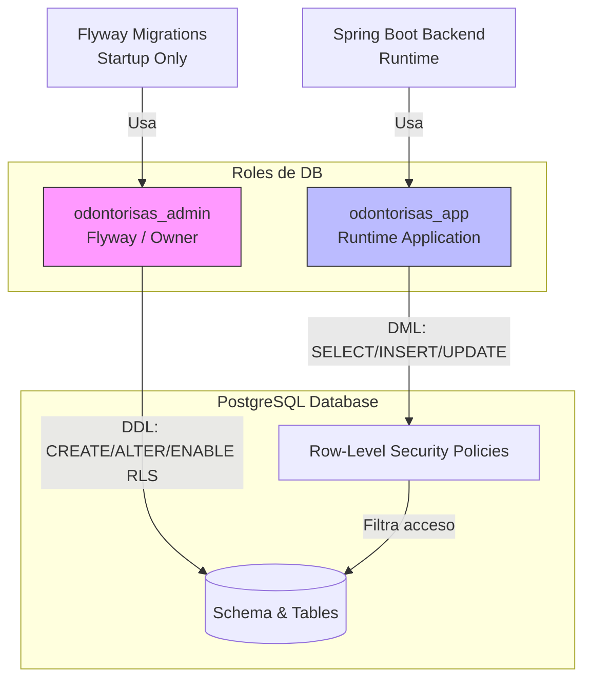

# Análisis y Propuestas de Mejora: Diseño de Multi-Tenancy en OdontoRisas

Este documento presenta un análisis técnico detallado del diseño propuesto para la transición a multi-tenancy en OdontoRisas, detallado en [design.md](file:///d:/proyectos/drivenSpec/OdontoRisas/Odontorisas/openspec/changes/add-multi-tenancy/design.md). Se identifican posibles riesgos arquitectónicos y de rendimiento, y se ofrecen propuestas de mejora concretas.

---

## 1. Separación de Privilegios en Base de Datos (Seguridad Crítica)

> [!IMPORTANT]
> **Riesgo:** El diseño actual propone utilizar un único usuario de base de datos (`DB_USERNAME`) que es el propietario (*owner*) de las tablas y el que ejecuta las migraciones de Flyway. Para que RLS aplique a este usuario, se utiliza `FORCE ROW LEVEL SECURITY`.
> 
> Si la aplicación sufre una vulnerabilidad de SQL Injection o si un atacante compromete el servidor de aplicación, al ser el usuario propietario de las tablas, tiene privilegios DDL completos y podría ejecutar:
> ```sql
> ALTER TABLE memberships DISABLE ROW LEVEL SECURITY;
> ```
> Esto anularía silenciosamente el aislamiento de datos.

### Propuesta de Mejora
Implementar el **Principio de Menor Privilegio** dividiendo los accesos en dos roles a nivel de base de datos:

1. **Usuario de Migraciones (Flyway Owner - `odontorisas_admin`):**
   - Propietario de los esquemas y tablas.
   - Tiene permisos DDL completos para crear, alterar y borrar estructuras.
   - No es utilizado por la aplicación en tiempo de ejecución.
2. **Usuario de la Aplicación (Runtime App - `odontorisas_app`):**
   - Tiene únicamente privilegios DML (`SELECT`, `INSERT`, `UPDATE`, `DELETE`).
   - Al **no** ser propietario de las tablas, **PostgreSQL le aplica RLS de manera obligatoria e ineludible**, sin necesidad de depender críticamente de `FORCE ROW LEVEL SECURITY` (aunque se puede mantener como defensa en profundidad).
   - No puede alterar políticas ni deshabilitar RLS.



### Configuración en Spring Boot
No se requiere configurar múltiples datasources Java en el contexto de la aplicación. Spring Boot soporta de forma nativa credenciales separadas para Flyway mediante propiedades estándar en `application.yml`:

```yaml
spring:
  datasource:
    url: jdbc:postgresql://localhost:5432/odontorisas
    username: odontorisas_app
    password: ${DB_APP_PASSWORD}
  flyway:
    user: odontorisas_admin
    password: ${DB_ADMIN_PASSWORD}
```

---

## 2. Compatibilidad de `set_config` con H2 (Slices de Test)

> [!WARNING]
> **Riesgo:** El interceptor de Hibernate (`afterTransactionBegin`) ejecutará `SELECT set_config('app.user_id', ?, true)` en cada transacción.
> 
> Dado que H2 es la base de datos utilizada para los slices de test (`docs/testing.md`) y no cuenta con una función nativa `set_config`, todos los tests unitarios y de integración basados en H2 **fallarán en el arranque de cualquier transacción** al no encontrar la función.

### Propuesta de Mejora
Existen dos alternativas recomendadas para solucionar esta incompatibilidad:

#### Opción A: Crear un Alias de Función en H2 (Recomendada)
Podemos registrar una función Java en H2 que actúe como alias de `set_config`. De esta manera, el código de producción permanece 100% agnóstico y limpio.

1. **Crear una clase auxiliar de test en Java:**
   ```java
   package com.odontorisas.test;
   
   public class H2Functions {
       private static final ThreadLocal<java.util.Map<String, String>> settings = 
           ThreadLocal.withInitial(java.util.HashMap::new);

       public static String setConfig(String name, String value, boolean isLocal) {
           settings.get().put(name, value);
           return value;
       }

       public static String currentSetting(String name) {
           String val = settings.get().get(name);
           if (val == null) {
               throw new RuntimeException("Setting " + name + " is not set");
           }
           return val;
       }
   }
   ```

2. **Registrar los alias en H2 al iniciar los tests (vía script de inicialización o bean de test):**
   ```sql
   CREATE ALIAS IF NOT EXISTS set_config FOR "com.odontorisas.test.H2Functions.setConfig";
   ```

#### Opción B: Interceptor Condicional por Dialecto
Hacer que el interceptor de Hibernate o DataSource delegado detecte el dialecto de la base de datos y solo envíe los comandos `set_config` si la base de datos es PostgreSQL:

```java
@Component
public class TenantInterceptor implements StatementInspector {
    private boolean isPostgres;

    @Autowired
    public TenantInterceptor(DataSource dataSource) {
        try (Connection conn = dataSource.getConnection()) {
            String dbName = conn.getMetaData().getDatabaseProductName();
            this.isPostgres = "PostgreSQL".equalsIgnoreCase(dbName);
        } catch (SQLException e) {
            this.isPostgres = false;
        }
    }

    // ... Solo ejecutar set_config si isPostgres es true
}
```

---

## 3. Optimización de Rendimiento: Agrupación de `set_config`

> [!TIP]
> **Riesgo:** Ejecutar dos sentencias independientes `SELECT set_config('app.user_id', ?, true)` y `SELECT set_config('app.organization_id', ?, true)` introduce dos viajes de ida y vuelta (round-trips) de red por cada inicio de transacción. Esto puede duplicar el overhead de base de datos en peticiones cortas.

### Propuesta de Mejora
Agrupar la inicialización de ambas variables de sesión en una única llamada de base de datos para reducir la latencia de red al 50%:

```sql
SELECT set_config('app.user_id', ?, true), set_config('app.organization_id', ?, true);
```

En JDBC/Hibernate, se puede ejecutar como una única consulta nativa:

```java
entityManager.createNativeQuery(
    "SELECT set_config('app.user_id', :userId, true), set_config('app.organization_id', :orgId, true)"
)
.setParameter("userId", currentUserId)
.setParameter("orgId", currentOrgId)
.getSingleResult();
```

---

## 4. Propagación de Contexto en Hilos Asíncronos

> [!WARNING]
> **Riesgo:** Los contextos `IdentityContext` y `OrganizationContext` se almacenan en variables `ThreadLocal`. Si la aplicación ejecuta métodos anotados con `@Async`, tareas programadas (`@Scheduled`), llamadas de reactive programming o procesamiento en paralelo, los nuevos hilos de ejecución **no heredarán estos valores**.
> 
> Cualquier consulta realizada en estos hilos secundarios fallará ruidosamente al no tener definidas las variables `app.user_id` ni `app.organization_id`.

### Propuesta de Mejora
Configurar un `TaskDecorator` personalizado para el `ThreadPoolTaskExecutor` de Spring, asegurando que el contexto de tenant se propague automáticamente al delegar tareas a hilos secundarios.

```java
public class TenantContextTaskDecorator implements TaskDecorator {
    @Override
    public Runnable decorate(Runnable runnable) {
        // Capturar el contexto del hilo principal (padre)
        Long userId = IdentityContext.getUserId();
        Long orgId = OrganizationContext.getOrganizationId();

        return () -> {
            try {
                // Establecer el contexto en el hilo secundario (hijo)
                IdentityContext.setUserId(userId);
                OrganizationContext.setOrganizationId(orgId);
                runnable.run();
            } finally {
                // Limpiar siempre para evitar fugas en el pool de hilos
                IdentityContext.clear();
                OrganizationContext.clear();
            }
        };
    }
}
```

Registrar el decorador en la configuración del Executor:
```java
@Configuration
@EnableAsync
public class AsyncConfig {
    @Bean
    public Executor taskExecutor() {
        ThreadPoolTaskExecutor executor = new ThreadPoolTaskExecutor();
        executor.setCorePoolSize(5);
        executor.setMaxPoolSize(10);
        executor.setQueueCapacity(25);
        executor.setTaskDecorator(new TenantContextTaskDecorator());
        executor.initialize();
        return executor;
    }
}
```

---

## 5. Prevención de Errores: Validación Temprana del Contexto

> [!NOTE]
> **Riesgo:** Si un usuario inicia sesión pero aún no ha seleccionado una organización (o si un token mal formado carece del claim `oid`), una llamada a un endpoint de negocio (por ejemplo, `/api/patients`) causará que `app.organization_id` sea `null`.
> 
> PostgreSQL RLS evaluará `organization_id = null` (que da `UNKNOWN`/`FALSE`) y la consulta no devolverá filas. La aplicación probablemente responderá con un error genérico `500` o `404 Not Found` (dando a entender que el recurso no existe, cuando en realidad es un fallo de autorización).

### Propuesta de Mejora
1. **Validación Temprana en el Filtro/Interceptor:**
   Implementar un interceptor o filtro de Spring Security que valide si la ruta solicitada requiere un contexto de organización (rutas de negocio) y, si `OrganizationContext` está vacío, devuelva inmediatamente una respuesta estructurada con código `400 Bad Request` o `403 Forbidden` indicando la falta de tenant (`ORGANIZATION_CONTEXT_REQUIRED`). Esto evita viajes innecesarios a la base de datos y proporciona una experiencia de depuración mucho más clara para el frontend.
   
2. **Uso de `missing_ok` en `current_setting`:**
   En lugar de escribir la política de RLS como:
   ```sql
   USING (organization_id = current_setting('app.organization_id')::bigint)
   ```
   Escribirla usando el segundo parámetro opcional `missing_ok = true`:
   ```sql
   USING (organization_id = current_setting('app.organization_id', true)::bigint)
   ```
   Esto evita que PostgreSQL lance un error crítico en consultas del sistema o de administración (como herramientas de monitoreo o de migraciones) donde la variable de sesión no se haya inicializado, evaluando a `NULL` de manera segura y manteniendo el principio de denegación por defecto (*fail-closed*).

---

## 6. Riesgo de Auto-commit y Consultas No Transaccionales

> [!CAUTION]
> **Riesgo:** Si se ejecutan consultas fuera del ámbito de una transacción activa (por ejemplo, consultas de sólo lectura sin `@Transactional` o con propagación `NOT_SUPPORTED`), el modificador `true` en `set_config(..., true)` provoca que la variable se descarte inmediatamente después de que finalice la ejecución de esa única sentencia (auto-commit).
> 
> Las consultas subsiguientes en la misma conexión del pool se ejecutarán sin que las variables estén definidas, provocando bloqueos de RLS inesperados.

### Propuesta de Mejora
1. **Enforzar Transaccionalidad:**
   Documentar explícitamente en `docs/backend.md` que **todas** las operaciones de repositorio que accedan a entidades RLS deben estar envueltas en una transacción activa (`@Transactional` o `@Transactional(readOnly = true)`).
2. **Validación por Arquitectura (ArchUnit):**
   Añadir un test de ArchUnit para asegurar que las clases de servicio o repositorios que interactúen con entidades multi-tenant tengan anotaciones transaccionales adecuadas, reduciendo la probabilidad de error humano.

---

## Summary of Recommendations

| Área | Decisión Original | Riesgo Identificado | Mejora Sugerida |
|---|---|---|---|
| **Seguridad de DB** | Un solo usuario con `FORCE RLS`. | SQL Injection podría desactivar RLS en caliente al ser propietario. | Separar usuario de Migraciones (Owner) del usuario de la App (DML no-owner). |
| **Testing** | Slices H2 de test. | H2 no soporta `set_config` nativo y fallará en transacciones. | Crear un Alias de función Java en H2 para `set_config` o interceptar condicionalmente. |
| **Rendimiento** | Dos `set_config` separados. | Dos round-trips extra por transacción. | Agrupar en un solo `SELECT set_config(...), set_config(...)`. |
| **Asincronismo** | Contexto en `ThreadLocal`. | Pérdida de tenant ID en `@Async` o pools paralelos. | Implementar `TaskDecorator` para heredar contextos en hilos hijos. |
| **UX & Depuración** | RLS deniega por defecto (`null`). | Respuesta confusa (`404` / `500`) si falta el claim `oid`. | Filtro de validación temprana que responda `403` si el endpoint de negocio no tiene tenant. |
