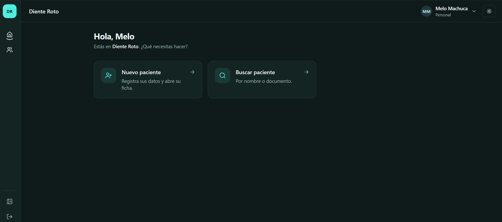
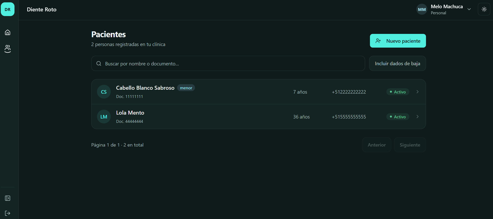
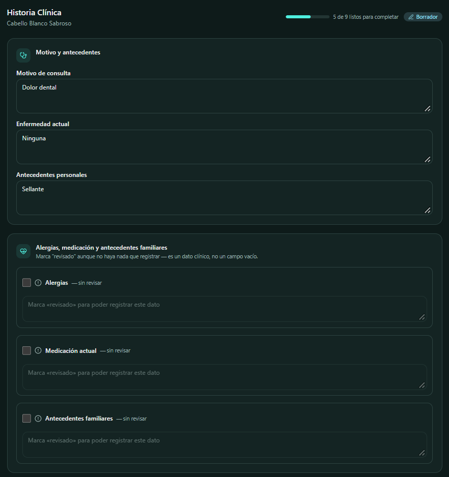
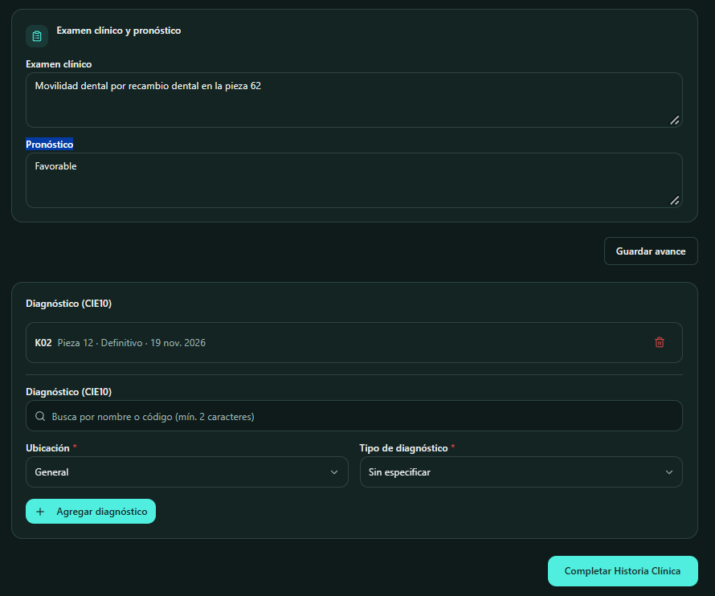
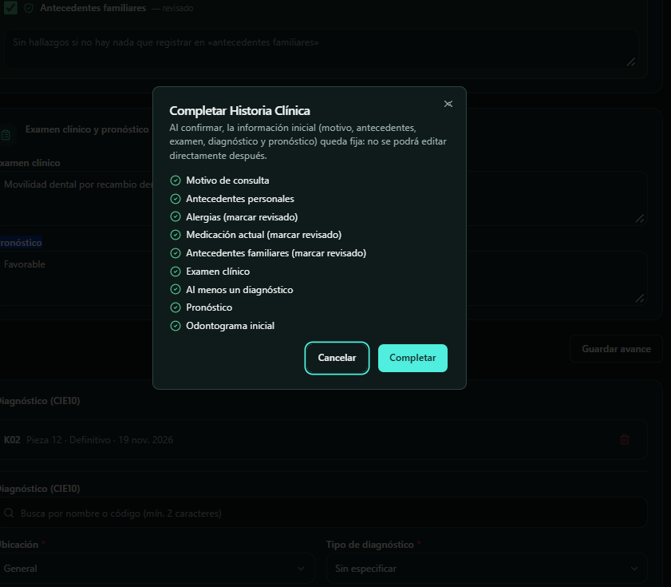
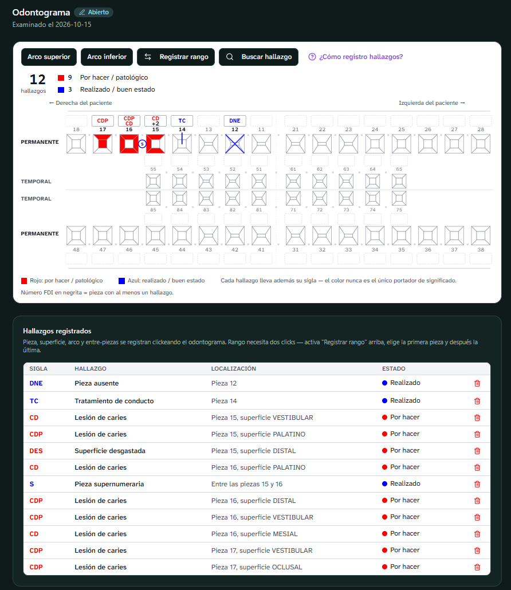
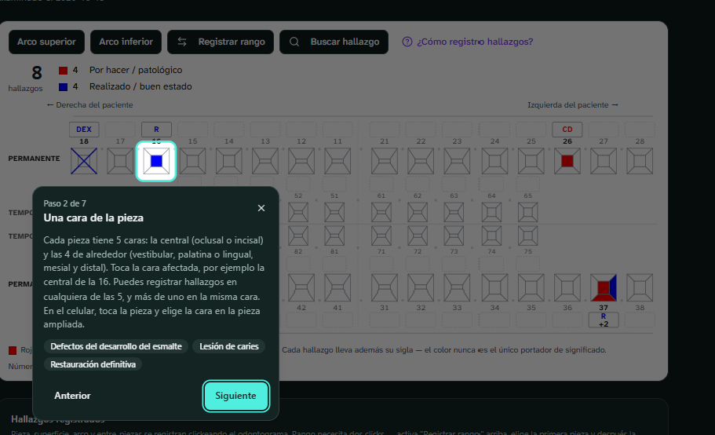
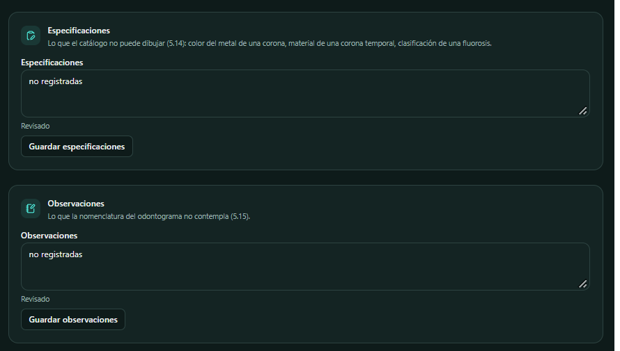

# DentDesk

Software odontológico **multi-clínica** (SaaS), en desarrollo, construido sobre las normas legales
de la odontología peruana: el odontograma, la historia clínica y el registro de la información
clínica siguen la norma, y solo los registra personal apto y habilitado. Cada clínica trabaja con
sus datos aislados de las demás.

- **Problema:** el software odontológico del mercado peruano cubre bien agenda, pacientes y
  facturación, pero la información clínica tiene exigencias legales propias que suelen quedar fuera:
  - **Historia clínica** (NTS 139): lo registrado no se reescribe. Las correcciones son registros
    nuevos y la historia se conserva 20 años.
  - **Odontograma** (NTS 188): catálogo oficial de hallazgos, con sigla y color según la norma.
  - **Quién registra**: cada acto clínico lo firma un odontólogo con colegiatura (COP) vigente,
    y queda la constancia de quién firmó.
  - **Datos personales** (Ley 29733): la clínica es la titular de los datos y DentDesk el encargado de tratarlos.

  DentDesk aplica esas reglas en el modelo de datos y en la base, no solo en la interfaz.
- **Para quién:** clínicas y consultorios dentales pequeños y medianos. Usuarios: administradores de
  la clínica, recepción y odontólogos. El paciente no tiene cuenta.
- **Estado:** en desarrollo activo, desplegado en un entorno de producción y usado solo con datos de
  prueba. Todavía no tiene clínicas ni pacientes reales. Agenda de citas, tratamientos y cobros
  están planificados, no implementados (ver [Estado de las funcionalidades](#estado-de-las-funcionalidades)).

> "OdontoRisas" aparece en identificadores internos (package `com.odontorisas`, roles de base de
> datos, carpeta local). Se conserva por compatibilidad: el nombre del producto es DentDesk.

---

## Capturas

Datos ficticios de una clínica de prueba.

**Inicio**



**Pacientes**



**Historia clínica**: la admisión se llena por partes y solo se completa cuando el checklist está
cumplido. Desde ahí queda fija.

| Motivo, antecedentes y checklist | Diagnóstico CIE10 por pieza |
|---|---|
|  |  |



**Odontograma**: hallazgos con sigla y color según la NTS 188, su lista y la guía paso a paso.



| Guía paso a paso sobre el odontograma | Especificaciones y observaciones |
|---|---|
|  |  |

---

## Estado de las funcionalidades

### Implementadas

**Acceso y cuenta**
- Inicio de sesión con access token en memoria y refresh token en cookie `httpOnly` con rotación.
- Bloqueo temporal de la cuenta por intentos fallidos.
- Alta de usuarios **solo por invitación**: enlace por correo más código de verificación. No hay registro público.
- *Mi perfil*: corregir el nombre y cambiar la contraseña (cierra las otras sesiones).
- Recuperación de contraseña por correo: enlace de un solo uso, límites por cuenta y por IP, respuesta neutra.

**Clínicas y personal**
- Varias clínicas en la misma instalación, con aislamiento de datos en la base (ver [Arquitectura](#arquitectura-y-decisiones-técnicas)).
- Roles `ADMIN` y `MEMBER` por clínica. Un administrador de plataforma da de alta las clínicas por API (sin pantalla propia).
- Gestión del personal: invitar, reenviar o revocar invitaciones, desactivar y reactivar miembros.
- Credencial profesional (colegiatura COP) declarada por el propio odontólogo, con vencimiento. Firmar actos clínicos la exige.
- Marca por clínica: color de un catálogo con contraste verificado (WCAG AA) y logo, en modo claro y oscuro.

**Pacientes**
- Alta, edición, baja que archiva y reactivación. Listado con búsqueda que se conserva al volver.
- Documento único por clínica. Responsable obligatorio para menores. Aviso de teléfono compartido.

**Historia clínica**
- Documento inicial único por paciente, de borrador a completado. Una vez completado no se modifica.
- Diagnósticos CIE10 con búsqueda jerárquica, tipo (presuntivo, definitivo o repetitivo) y pieza dental.
- Notas de consulta posteriores: se sellan, las correcciones se registran como un asiento nuevo y los antecedentes como altas y bajas.

**Odontograma**
- Odontograma inicial interactivo en SVG: hallazgos por superficie, pieza, entre piezas, rango y arco (numeración FDI, dentición permanente y temporal).
- Catálogo cerrado de 38 hallazgos alineado a la norma técnica vigente, con sigla y color oficiales.
- Sellado junto con la historia clínica; queda inmutable, protegido también por triggers en la base.
- Guía paso a paso, búsqueda de hallazgos por nombre y vista ampliada de cada pieza en pantallas táctiles.

**Plataforma**
- Interfaz responsive con barra lateral contraíble e Inicio con bienvenida y atajos.
- Copia diaria cifrada de la base de datos fuera del proveedor, con restauración verificada automáticamente.

### Parcialmente implementadas

- **Odontograma:** solo el odontograma inicial. Faltan los odontogramas de evolución y la comparación entre fechas.
- **Control de acceso clínico:** firmar exige credencial vigente, pero un miembro sin credencial todavía puede *ver* la información clínica.
- **Administración de plataforma:** el alta de clínicas funciona por API (script `modules/backend/scripts/new-clinic.ps1`), sin interfaz.

### Planificadas (no implementadas)

Agenda de citas, tratamientos, planes de tratamiento con presupuesto, cobros al paciente,
suscripción de las clínicas, imágenes clínicas, inventario y panel de métricas. Orden y alcance en
[`docs/vision.md`](docs/vision.md).

---

## Arquitectura y decisiones técnicas

```
React (Vercel)  --/api/*-->  Spring Boot (Render, Docker)  -->  PostgreSQL (Neon, RLS forzada)
      ^                               |
      +-- cliente generado (orval) <--+-- contrato OpenAPI versionado (contracts/openapi.json)
```

- **Frontend organizado por dominio.** `src/modules/{auth, patients, clinical-history, dental-chart, staff, branding, home}` más `core` con UI base, componentes genéricos y servicios. Las pantallas (`src/screens`) son finas y delegan en su módulo. Un archivo, un componente, verificado por ESLint.
- **Estado.** TanStack Query para el estado del servidor, Zustand para el de la aplicación. Formularios con React Hook Form y validación en esquemas Zod, en paridad con la validación del backend.
- **Backend por capas.** `presentation` → `service` → `persistence`, más `infra` y `common`. Las dependencias entre capas las verifica ArchUnit en cada build.
- **API REST bajo `/api`.** Errores en formato RFC 9457 (`application/problem+json`) con mensajes en español.
- **Contrato primero.** El backend publica OpenAPI. El contrato se versiona en `contracts/openapi.json` y orval genera los tipos y el cliente del frontend. El CI falla si el backend y el contrato, o el contrato y el cliente generado, no coinciden.
- **Aislamiento multi-clínica en la base.** Row-Level Security forzada en PostgreSQL, con dos roles: uno dueño de las tablas para migrar y otro de aplicación, solo DML y sin `BYPASSRLS`. El contexto de clínica se fija automáticamente en cada transacción. Una regla de ArchUnit impide fijarlo a mano desde código de negocio.
- **Autorización.** Rol administrativo por clínica (`ADMIN`/`MEMBER`). La capacidad clínica depende de una credencial profesional vigente, no del rol.
- **Persistencia.** JPA/Hibernate con migraciones Flyway (sin `ddl-auto`). Autoría (`created_by`/`updated_by`) registrada automáticamente.
- **Documentos clínicos como libro de asientos.** Lo sellado no se reescribe: las correcciones y los cambios son registros nuevos.
- **Concurrencia.** Bloqueos pesimistas en los sellados y en los flujos de invitación y contraseña, con pruebas que usan hilos reales.

Las decisiones de fondo están en 20 ADRs ([`docs/adr/`](docs/adr/)), incluidas las de cumplimiento
normativo: NTS 139 (historia clínica), NTS 188 (odontograma) y Ley 29733 (protección de datos).

---

## Stack tecnológico

| Área | Tecnologías |
|---|---|
| Frontend | React 19, TypeScript, Vite, Tailwind CSS 4, componentes estilo shadcn/ui sobre Radix UI, lucide-react, Framer Motion |
| Estado y datos | TanStack Query 5, Zustand 5, React Hook Form, Zod 4, axios, React Router 7, orval |
| Backend | Java 25, Spring Boot 4 (Web MVC, Security, Data JPA, Validation, Mail, Actuator), springdoc-openapi, java-jwt, Caffeine, Lombok |
| Base de datos | PostgreSQL 16, Flyway, Row-Level Security |
| Testing | JUnit 5, Mockito, Testcontainers, ArchUnit, Vitest, Testing Library, MSW, Playwright |
| DevOps y CI/CD | GitHub Actions, Docker, Render, Vercel, Neon, Brevo (SMTP), cifrado `age` para las copias |
| Herramientas | pnpm (workspace), Maven Wrapper, ESLint, husky, lint-staged, commitlint, OpenSpec |

---

## Calidad y pruebas

| Tipo | Herramientas | Qué cubre |
|---|---|---|
| Unitarias (backend) | JUnit 5, Mockito | Reglas de negocio y servicios aislados |
| Integración (backend) | Spring Boot Test, Testcontainers (PostgreSQL real) | Endpoints, seguridad por rol, consultas, aislamiento RLS entre clínicas, migraciones con un dueño no superusuario, concurrencia |
| Arquitectura | ArchUnit | Dependencias entre capas, contexto de clínica, autoría obligatoria |
| Componentes y hooks (frontend) | Vitest, Testing Library, MSW | Pantallas, formularios y su validación, interacción con la API simulada |
| E2E de humo | Playwright (Chromium) | Rutas privadas sin sesión, validación del login, registro sin invitación y navegación del shell. Sin backend real: el shell usa respuestas simuladas |
| Contrato | `ContractDriftIT` y job `codegen-drift` | Backend, contrato y cliente generado sincronizados |

Las pruebas se derivan de los escenarios de cada especificación: un escenario WHEN/THEN, un test.
Para el backend, `*Test` corre con Surefire y `*IT` con Failsafe; los `*IT` necesitan Docker.
No hay un umbral de cobertura definido: el CI del frontend genera el reporte de cobertura, pero no
lo exige.

**CI (GitHub Actions):**
- `backend.yml`: `mvn verify`.
- `frontend.yml`: typecheck, lint, tests, deriva del cliente generado y E2E de humo.
- `openspec.yml`: validación estricta de especificaciones.
- `db-backup.yml`: copia cifrada diaria y su restauración de prueba.

Render despliega el backend solo con el CI en verde.

---

## Desarrollo guiado por especificaciones

El proyecto usa [OpenSpec](https://github.com/Fission-AI/OpenSpec). Cada capacidad se especifica
antes de construirse, con requisitos (`SHALL`) y escenarios verificables (`WHEN`/`THEN`):

```
explorar -> proponer (proposal, design, delta de spec, tasks) -> revisión humana -> implementar -> pruebas -> archivar
```

- [`openspec/specs/`](openspec/specs/) contiene solo lo **ya construido**: 11 capacidades.
- [`openspec/changes/archive/`](openspec/changes/archive/) guarda cada cambio con su propuesta, diseño y tareas.
- [`docs/vision.md`](docs/vision.md) une el roadmap, lo que está en curso y lo construido.

Detalle del flujo en [`SETUP-OPENSPEC.md`](SETUP-OPENSPEC.md).

---

## Ejecución local

**Requisitos:**
- JDK 25.
- Node 22 y pnpm 10.
- Docker, para PostgreSQL local y para las pruebas de integración.

### 1. Base de datos y backend

```bash
cd modules/backend
cp secrets.properties.example secrets.properties   # completar DB_* y JWT_SECRET
docker compose --env-file secrets.properties up -d  # PostgreSQL 16 local
./mvnw spring-boot:run                              # http://localhost:8080/api
```

- `JWT_SECRET` debe tener al menos 32 bytes aleatorios (`openssl rand -base64 48`). Con el valor de
  ejemplo la aplicación no arranca.
- Swagger UI y `/api/v3/api-docs` están apagados por defecto: se activan con `SWAGGER_ENABLED=true`
  en `secrets.properties`.

### 2. Frontend

```bash
pnpm install                             # desde la raíz: instala el workspace y los hooks de git
pnpm --filter dentdesk-frontend dev      # http://localhost:5173
```

Sin `VITE_API_URL`, en desarrollo el frontend usa `http://localhost:8080/api` (ver `modules/frontend/.env.example`).

### 3. Primer acceso

No hay registro público. Para entrar en local hace falta crear el administrador de plataforma, dar
de alta una clínica e invitar a su administrador. La invitación requiere SMTP configurado
(`MAIL_*`). El procedimiento completo está en [`docs/deployment.md` §11](docs/deployment.md).

### Pruebas

```bash
cd modules/backend && ./mvnw verify          # unitarias + integración (requiere Docker)
cd modules/backend && ./mvnw test            # solo unitarias, sin Docker
pnpm --filter dentdesk-frontend validate     # typecheck + lint + tests
pnpm --filter dentdesk-frontend test:e2e     # E2E de humo (Playwright)
```

### Regenerar el cliente de la API

```bash
curl -o contracts/openapi.json http://localhost:8080/api/v3/api-docs   # con SWAGGER_ENABLED=true
pnpm --filter dentdesk-frontend generate:api
```

---

## Documentación

| Documento | Contenido |
|---|---|
| [`docs/vision.md`](docs/vision.md) | Producto, roadmap y estado de cada capacidad |
| [`docs/domain.md`](docs/domain.md) | Modelo de dominio: actores, glosario y diagrama ER |
| [`docs/architecture.md`](docs/architecture.md) | Stack y arquitectura de backend y frontend |
| [`docs/backend.md`](docs/backend.md) | Estándares Java/Spring: capas, validación, JPA, seguridad, errores |
| [`docs/frontend.md`](docs/frontend.md) | Estándares frontend: módulos, cliente generado, React Query, Zustand, UI |
| [`docs/coding-style.md`](docs/coding-style.md) | Estilo de código y paridad de validación |
| [`docs/testing.md`](docs/testing.md) | Estrategia de pruebas y relación escenario-test |
| [`docs/tooling-setup.md`](docs/tooling-setup.md) | Tooling, CI y Testcontainers en local |
| [`docs/deployment.md`](docs/deployment.md) | Despliegue en Vercel, Render y Neon, copias de la base, operación |
| [`docs/adr/`](docs/adr/) | Registros de decisiones de arquitectura |
| [`docs/compliance/regulatory-matrix.md`](docs/compliance/regulatory-matrix.md) | Trazabilidad norma, decisión y requisito |
| [`docs/commits.md`](docs/commits.md) | Conventional Commits en español |
| [`SETUP-OPENSPEC.md`](SETUP-OPENSPEC.md) | Flujo y comandos de OpenSpec |
| [`CLAUDE.md`](CLAUDE.md) | Reglas del proyecto para agentes de IA |
